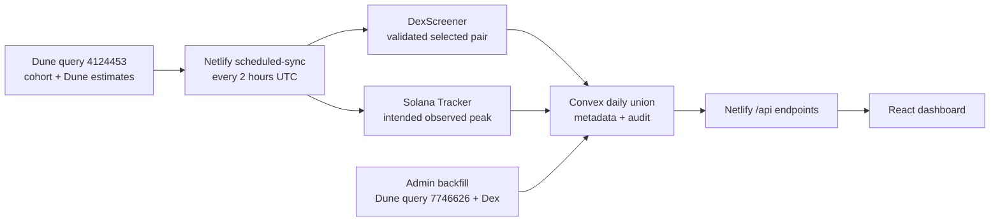

# Authoritative Session Handoff - 2026-07-27

## Purpose of this handoff

This is the final audited handoff for the session. It records the pipeline as it
exists after the July 2026 reliability, source-semantics, frontend,
daily-retention, and Solana Tracker work. It also records the release-blocking
issues found during review so a future session does not mistake passing tests
for a production-ready peak implementation.

The product goal remains: identify recently graduated Solana tokens that reached
a defensible observed peak market cap of roughly `$100k+`, including brief
runners that later died, and make the current meta easy to scan and investigate.

Important product decisions:

- Call the metric **observed peak market cap**, not ATH, until complete lifetime
  coverage is proven.
- A brief wick counts for this research tool. Do not silently remove it.
- Dune remains the cohort filter. Solana Tracker enriches already-selected
  tokens; it does not currently decide which tokens enter the dashboard.
- Do not treat the optional Dune peak, graduation, buy/sell, or measured-volume
  fields as populated. Production query `4124453` does not return them today.
- Missing a token that performed well is a product failure. App-side retention
  helps, but it is not proof of upstream completeness.

## Repository and deployment state

- Branch: `main`
- Local HEAD: `52f779e` (`Document production audit and next-session handoff`)
- `main` is one commit ahead of `origin/main`.
- Last verified production source commit: `93fad1c`
  (`Use Convex-compatible module names`).
- The pipeline/frontend/peak changes reviewed here are still uncommitted and
  have not been deployed.
- `.claude/launch.json` remains intentionally untracked.
- `AGENTS.md` is also currently untracked; review ownership before staging it.
- Production site: `https://metratrackerapp.netlify.app`
- Production Convex deployment: `dusty-ox-307`
- Production scheduled sync: `0 */2 * * *` UTC.

Final production health check at `2026-07-27T20:05:53Z`:

```text
HTTP 503, ok: false
Latest scheduled slot: 2026-07-27 20:00 UTC
App sync status: success
Incoming/stored tokens: 18/18
Dex enrichment: 18/18, zero failures
Retries: 0
Latest Dune execution: 2026-07-27T13:29:08Z
App-sync age: 4 minutes (limit 270)
Dune age: 397 minutes (limit 390)
```

The same endpoint returned HTTP 200 seven minutes earlier when Dune age was 389
minutes. The 20:00 app sync then completed successfully with the same 18-token
Dune result, but health correctly became 503 when that upstream execution
crossed the 390-minute stale limit. The application pipeline is running;
production is unhealthy specifically because Dune has not produced a newer
execution.

## Pipeline at a glance



Normal scheduled flow:

1. Record a best-effort `syncRuns` start row for the expected two-hour slot.
2. Download the latest completed result for Dune query `4124453`.
3. Reject empty, incomplete, malformed, paginated, or non-completed results.
4. Enrich every returned mint with a validated DexScreener pair.
5. Build candidates for Solana Tracker observed-peak enrichment.
6. Reserve a bounded amount of the monthly Solana Tracker request budget.
7. Fetch/reuse peaks and store them in the permanent peak cache.
8. Merge incoming mints into the current UTC day's retained token union.
9. Store the snapshot metadata and advance `duneMetadata`.
10. Mark the `syncRuns` row successful with incoming, retained, enrichment,
    peak-attempt, and provider-budget counts.

## Source semantics

### Dune: inclusion and measured-window estimates

Main query: `4124453`, a third-party public query owned by `adam_tehc`.

The app downloads the query's latest completed result; it does not trigger the
query. The query is a rolling recent window, not a token-created calendar-day
bucket. It supplies:

- mint/token address;
- symbol/asset;
- `duneMarketCap` from the query's recent-trade estimate;
- `duneVwapPrice`;
- `tradeCount`; and
- Dune execution identifiers and timestamps.

The result parser in `netlify/functions/_shared/token-sync.ts` validates:

- a real execution timestamp;
- completed query state;
- non-empty usable rows;
- row count equal to total row count;
- every returned row producing a usable token; and
- absence of a next page.

Dune currently remains the only cohort-discovery source. If Dune never returns
a token, neither DexScreener nor Solana Tracker can add it to the dashboard.

### DexScreener: later selected-pair state

For every Dune mint, the app calls the token endpoint and accepts only a pair
where:

- `chainId` is `solana`;
- the pair's base-token address exactly equals the requested mint; and
- the pair address is a plausible Solana address.

It then selects the matching pair with the highest reported USD liquidity and
stores its address. DexScreener supplies:

- name, symbol fallback, image, banner, website, and socials;
- `dexMarketCap` and `dexPriceUsd`;
- selected-pair 24-hour volume, liquidity, and price change;
- pair creation time;
- selected pair address and DexScreener link; and
- `dexFetchedAt` capture time.

These values are captured after the Dune execution and can legitimately differ
greatly from the Dune market-cap/price estimates. Historical tabs preserve the
captured values; they do not re-fetch DexScreener.

The additive fields are source-explicit, but the compatibility fields are not
fully source-strict. Legacy `marketCap` prefers Dune and falls back to Dex when
the Dune value is zero or missing; legacy `priceUsd` behaves the same way. The
detail drawer reads the explicit Dune fields first, while the current table and
summary still render legacy `marketCap`. Their `Dune MC` labels are therefore
normally correct for the current query but are not guaranteed until those views
prefer `duneMarketCap` explicitly.

The dashboard's combined Dex volume is the sum of each token's selected-pair
24-hour volume, not a complete all-pools volume measure.

### Solana Tracker: intended observed peak

The uncommitted implementation uses the token chart endpoint with one-minute
candles. Its intended behavior is:

- search a bounded recent chart window;
- include the highest candle wick;
- calculate/store observed peak market cap, price, time, supply, supply source,
  provider source, and fetch time;
- keep the greater peak when a later observation is supplied;
- cache peaks by mint across snapshot dates; and
- limit usage to 2,200 requests per month, leaving 300 requests of the free
  2,500-request plan as headroom, with no more than eight requests per sync.

This stage is **not production-ready**. See the blocking findings below.

## Convex storage and snapshot behavior

Relevant tables:

- `graduatedTokens`: token rows keyed by snapshot date and mint.
- `dailySnapshots`: source/snapshot metadata and capture mode for each UTC date.
- `duneMetadata`: latest durably stored Dune execution metadata.
- `syncRuns`: scheduled-run audit and health source.
- `observedPeaks` (new, uncommitted): permanent peak cache by mint.
- `providerUsage` (new, uncommitted): monthly Solana Tracker reservations.

The scheduled path now requests a **daily observed union**:

- an incoming mint replaces its earlier same-day row with fresher enrichment;
- a mint missing from a later rolling Dune result is retained with its last
  same-day values; and
- the snapshot token count becomes the union size, while `syncRuns.tokenCount`
  records the current incoming Dune count.

This prevents later syncs from deleting a token already observed that UTC day.
It does not recover tokens Dune missed between executions. Historical snapshots
created before union mode remain final rolling snapshots.

Only scheduled sync and authorized admin backfill are intended to write durable
token snapshots. Browser/manual live requests can fetch Dune and Dex data but
must not advance `duneMetadata` unless a matching snapshot is stored. This
ownership is not currently enforced at the Convex function boundary: the write
mutations are public, as documented in the security finding below.

## API and frontend behavior

### API

- `/api/graduated?mode=live`: normally serves today's Convex cache after a Dune
  metadata freshness check.
- Authorized `force=true` or a cache miss: fetches Dune + Dex directly but does
  not write the durable snapshot and does not run peak enrichment.
- `/api/graduated?mode=historical&date=YYYY-MM-DD`: serves the stored date.
- `/api/available-dates`: lists snapshot dates, counts, and capture modes.
- `/api/health`: evaluates recent successful sync and Dune execution age from
  `syncRuns`; it does not currently evaluate cohort-size degradation.
- `/api/backfill`: authorized, parameterized Dune backfill plus Dex enrichment,
  exact replacement. It does not currently run Solana Tracker peak enrichment.

### Frontend

The uncommitted frontend redesign was visually inspected at
`http://localhost:8888/` and had no browser-console warnings or errors.

Confirmed improvements:

- cleaner hierarchy and less decorative dashboard chrome;
- explicit `Dune MC`, Dex activity, and `Peak MC` columns;
- compact snapshot overview and date selector;
- missing peak values render honestly as a dash and sort below real values;
- the detail drawer separates Dune, DexScreener, and Solana Tracker timing;
- selected Dex pair identity is available in the drawer; and
- old snapshots remain compatible when new fields are absent.

The local preview's Peak MC column is empty when it reads production data. The
deployed production frontend does not yet contain that column. Production's 18
live API tokens had zero populated peak or other extended Dune fields at final
verification; no reviewed peak implementation has been deployed.

## Release-blocking findings

### 1. Solana Tracker raw HTTP parameters are wrong and wick outliers may be filtered

Current code sends `timeFrom` and `timeTo` to the raw chart endpoint. The
documented raw HTTP parameters are `time_from` and `time_to`. The provider's SDK
example uses camel-case options, but that does not establish camel case as the
raw request contract.

The endpoint also defaults `removeOutliers` to `true`. The current request does
not override it, contradicting the explicit decision that a brief wick counts.
The unit test currently asserts the wrong camel-case query parameters.

Required correction:

- send `time_from` and `time_to`;
- send `removeOutliers=false`;
- strongly prefer `marketCap=true` and consume market-cap candles directly
  rather than inferring supply from mixed-time Dune/Dex values; and
- update the request test to match the official raw HTTP contract.

Official reference:
`https://docs.solanatracker.io/data-api/chart/get-ohlcv-data-for-a-token`

### 2. A token's peak is fetched only once

After `observedPeakFetchedAt` exists, the enrichment loop permanently skips the
mint. If the first check sees `$150k` and the token reaches `$2m` later, the
stored peak remains `$150k` forever.

The cache mutation correctly preserves a higher value if it receives one, but
the scheduler never performs the later request needed to discover it.

Required correction: define a bounded lifecycle, for example an initial check
plus one or more delayed/final refreshes through the chosen observation window,
always retaining the maximum.

### 3. The missing-peak queue is not durable

The scheduler only loads today's and yesterday's token rows before building peak
candidates. If budget exhaustion or provider failures delay a token beyond that
window and the token has left Dune's rolling result, it disappears from the
candidate set forever.

The chart query is also capped to a 48-hour lookback, so delayed work can miss
the original run even if rediscovered.

Required correction: add a durable job/coverage record by mint with status,
retry timing, attempts, first/last observation times, and completion/finalization
state, or query every stored mint still missing a finalized peak oldest-first.

### 4. Convex writes and the scheduled endpoint are unauthenticated

The new `convex/observedPeaks.ts` file exposes public `upsertMany` and
`reserveRequests` mutations without verifying a server secret or authenticated
identity. This expands an existing public write surface: `storeSnapshot`,
`duneMetadata.update`, all `syncRuns` writes, and `dailySnapshots.deleteByDate`
are also declared with public `mutation` and do not check `ctx.auth`.

An external caller who knows the public Convex deployment can attempt direct
snapshot/metadata/audit writes, request historical overwrite behavior, inject
arbitrary peak values, patch historical token rows, or consume the local monthly
budget. Argument and source guards limit some malformed writes but are not
authorization.

The Netlify `scheduled-sync` background handler also ignores the incoming
request and performs no authentication. Its public endpoint can be invoked
outside the registered Netlify schedule, triggering provider calls and write
attempts.

Required correction: make all operational writes server-authorized, not only the
new peak mutations. Use a scheduled dispatcher/authenticated background worker
or another design that preserves the required background runtime, and expose
only the minimum authenticated Convex boundary. Do not rely on unguessable names
or the frontend not calling a public mutation.

### 5. Daily union bypasses the source-collapse guard and can make health green

When `preserveExistingTokens` is true, snapshot storage bypasses the existing
retention-ratio guard. This avoids deletion, but a collapse from 15 incoming
tokens to 4 can become a successful sync that retains the old 15-token union.

`/api/health` only checks the recency of a successful sync and the Dune execution
timestamp. It can therefore report healthy while the incoming cohort is severely
degraded and new tokens are being missed.

Required correction: preserve the prior union but separately classify/alert the
run as degraded when the incoming count collapses unexpectedly. Keep incoming
and union counts visible and incorporate coverage degradation into health or a
separate alert signal.

## Important coverage limitations

These are not necessarily implementation bugs, but they prevent a claim of
gap-free data:

1. Dune remains the only discovery source. Solana Tracker cannot recover a mint
   that Dune never returned.
2. Query `4124453` is externally controlled and may execute less often than the
   application's two-hour sync.
3. One union record per UTC date is updated every two-hour sync, but it retains
   only tokens seen by successful source downloads. It does not capture tokens
   that appear and disappear between Dune executions.
4. The local 2,200-request counter does not reconcile against Solana Tracker's
   actual credit endpoint. Other use of the same API key consumes credits without
   updating Convex.
5. Backfilled historical dates do not receive peak enrichment today.
6. Until the peak lifecycle is fixed, the UI label “highest observed 1m candle”
   overstates the coverage behind the number. The drawer should show the actual
   checked window and whether observation is provisional or finalized.

## What was confirmed correct

- Dune and Dex now have explicit additive fields and separate capture times.
  Legacy compatibility fields still retain Dune-preferred Dex fallback behavior.
- Dune result state, execution time, completeness, usable rows, and pagination
  are guarded.
- Dex pair selection validates the chain, base mint, and pair address and stores
  the selected pair identity.
- The daily-union merge correctly refreshes incoming mints and retains missing
  same-day mints without duplication.
- Existing live and historical API response shapes remain compatible when new
  fields are absent.
- Missing peak values are not represented as zero or fabricated ATH values.
- The redesigned UI is materially simpler and easier to scan.
- Browser inspection found no console warnings/errors in the main table or
  detail drawer.

Verification rerun against the uncommitted worktree on 2026-07-27:

```text
npm run test:health                      38/38 passed
npm run build                            passed; known chunk-size warning only
npm run typecheck:functions              passed
npx tsc --noEmit -p convex/tsconfig.json passed
git diff --check                         passed
```

Passing checks do not cover the provider-contract, peak-lifecycle, durable-queue,
write-authorization, or degraded-health issues above.

## Recommended next-session order

1. Re-read this document, then check `git status` and `/api/health` before
   editing. Preserve all current user/session changes and keep
   `.claude/launch.json` untracked.
2. Design and implement authorization for all operational Convex writes and the
   publicly invokable scheduled background path. Preserve the 15-minute worker
   runtime and Netlify cron registration.
3. Correct the Solana Tracker raw request parameters, disable outlier removal,
   use market-cap candles where supported, and fix the tests.
4. Design the peak observation lifecycle and durable queue together. Do not
   patch only the one-time cache and leave delayed candidates lossy.
5. Preserve daily unions while adding a degraded-source signal for sharp
   incoming-count collapses; ensure `/api/health` cannot silently hide missing
   new tokens.
6. Make the table, sorting, and summary prefer explicit `duneMarketCap` while
   retaining legacy fallback only for old snapshots, then update the drawer to
   show the peak coverage window and provisional/finalized status.
7. Rerun all checks and visually inspect desktop, mobile, date switching,
   sorting, and a token drawer using real cached data.
8. Deploy in reversible stages: Convex schema/write protection, Functions and
   pipeline, then frontend. Verify the Netlify cron registration after any
   Functions deploy.
9. Only after the peak path is trustworthy, resume shadow work for graduation
   time, buy/sell counts, measured volume, and independent coverage comparison.

## Deployment warning

Do **not** deploy the current uncommitted peak implementation as-is. The frontend
and source-semantics changes are coherent, but the peak values can be incomplete,
filtered contrary to product intent, permanently frozen too early, dropped from
the pending candidate set, and written through unauthenticated mutations. The
existing public Convex write surface and unauthenticated scheduled endpoint must
also be addressed before treating the backend as protected from external writes
or provider-trigger abuse.
